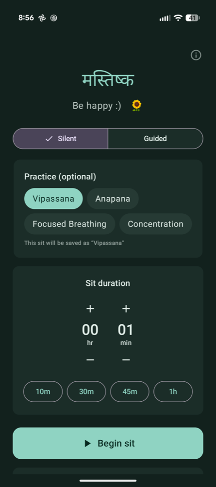
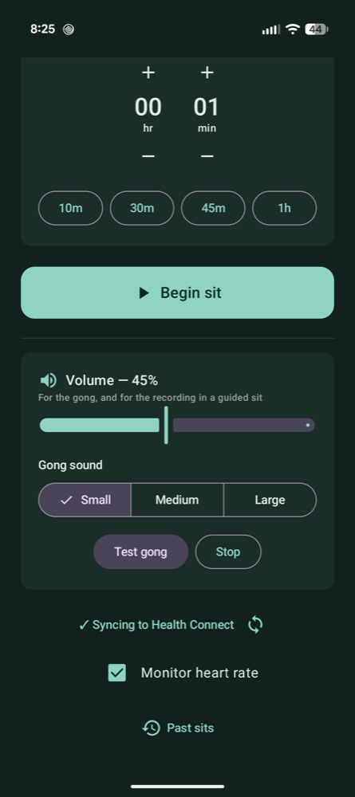
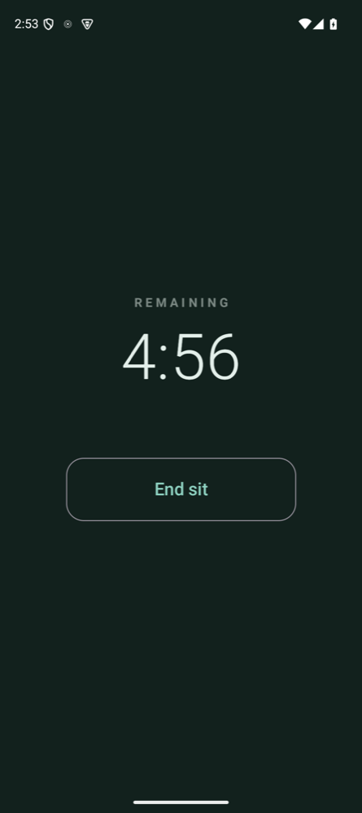
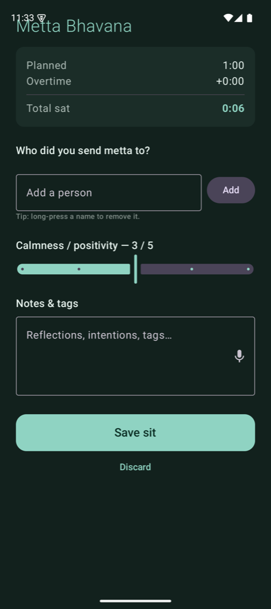
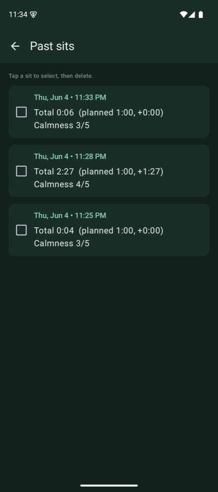
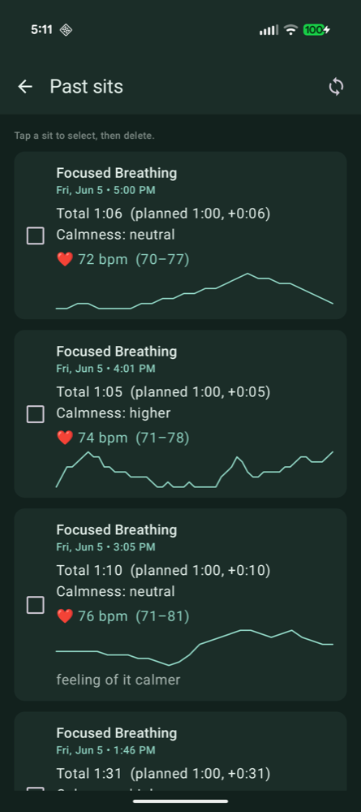

# Mastishka · मस्तिष्क

A barebones meditation companion for Vipassana sits — one product, three platforms.

The signature, everywhere: set a duration; at zero the **gong rings without interrupting
you**, and the timer keeps counting **overtime** so you know exactly how much longer you sat.

| Platform | Where | What |
|---|---|---|
| **Android** | [`android/`](android/) · releases tagged `v*` | The full app: sit timer, practice types, metta, notes, heart rate via Health Connect, multi-device history with device filter, automatic Drive sync |
| **macOS** | [`macos/`](macos/) · releases tagged `mac-v*` | Minimal menu-bar companion: breathing orb sit, gong, overtime, saves to the shared Drive folder; `mastishka://sit` URL scheme |
| **Web** | [`docs/`](docs/) → **[nishparadox.com/mastishka](https://nishparadox.com/mastishka/)** | A transient sit in the browser — nothing saved, just open and sit |

## One history, across devices

Sits sync as plain files — no server, no accounts, no cloud API
(see **[`specs/ecosystem-protocol.md`](specs/ecosystem-protocol.md)**, the contract every
platform implements):

```
Google Drive/nishparadox/mastishka/sits/
  pixel-9-xxxxxx.jsonl     ← written only by the phone
  mac-m3-max-xxxxxx.jsonl  ← written only by that Mac
```

One line = one sit (time, durations, practice, calmness, notes, metta people, heart data).
Each device writes only its own file — conflict-free by construction — and every reader
shows the union, deduped by start time. On Android this is **one folder grant, then
automatic**: other devices' sits appear on their own (filterable by device chips), flow
into Health Connect, and get enriched with your band's heart rate by time-correlation.
The same protocol defines the `mastishka://sit` URL scheme so companion apps (like
[vishrama](https://github.com/NISH1001/vishrama)) can trigger a tracked sit.

## Screenshots (Android)

<p>
  
  
  
  
  
  
</p>

## Project layout

```
android/   Kotlin + Jetpack Compose app (Gradle project — see android/README.md)
macos/     Swift 6 + SwiftUI menu-bar app (SwiftPM, no Xcode — see macos/README.md)
docs/      the web sit (GitHub Pages) + screenshots
specs/     ecosystem protocol + design specs
scripts/   gong additive synthesis (renders OGG for Android, AAC for macOS)
```
