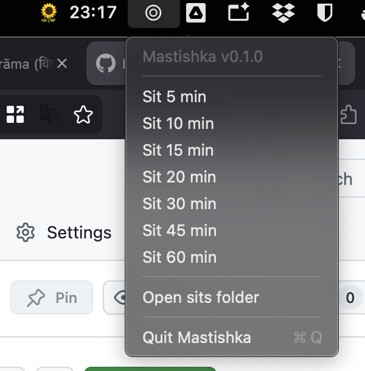

# Mastishka — macOS

A deliberately minimal menu-bar sit companion (Swift 6 + SwiftUI, SwiftPM, **no Xcode
required** — Command Line Tools only). It does three things: hear the doorbell, run a sit,
write the line.



Built as a companion to **[vishrama](https://github.com/NISH1001/vishrama)** (the same
author's macOS break reminder): when a long break says *Anapana*, vishrama opens the
`mastishka://sit` URL below and this app runs — and tracks — the sit, so vishrama never
grows meditation features of its own.

- **Menu bar ◎** → *Sit N min*. The sit window: night gradient, mint breathing orb
  (10 s raised-cosine breath), countdown → **gong once at zero without interrupting** →
  overtime counts up → calmness + optional note → save.
- **`mastishka://sit?practice=anapana&minutes=10&autostart=1&source=vishrama`** — the
  URL scheme other apps use to trigger a tracked sit
  ([`../specs/ecosystem-protocol.md`](../specs/ecosystem-protocol.md) §1). A live sit is
  never interrupted.
- Sits append to `Google Drive/nishparadox/mastishka/sits/mac-<chip>-<uuid6>.jsonl`
  (canonical schema 1 — the same lines the Android app reads/writes), with an
  Application Support fallback. Idle sleep is held off while sitting.

## Build & run

```sh
# from this macos/ directory:
./scripts/build-app.sh     # swift build + assemble dist/Mastishka.app + sign + launch
./scripts/test.sh          # unit tests (wraps the CLT Testing.framework paths)
```

Data root autodetects the Google Drive desktop mount; override with:

```sh
defaults write dev.nishparadox.mastishka dataRoot ~/some/other/folder
```

## Try the doorbell

```sh
open "mastishka://sit?practice=anapana&minutes=1&autostart=1"
```

## Code map

```
Sources/MastishkaCore/     # pure logic, unit-tested: SitTimer (gong-once + overtime
                           # rules), SitRecord (schema-1 JSON), SitLogStore (jsonl
                           # union/dedupe), SitCommand (URL parsing), TimeFormat
Sources/Mastishka/         # app shell: menu bar, sit window + orb (Canvas), gong
                           # (AVAudioPlayer over m4a renders), power assertion,
                           # data-location resolution
Sources/Mastishka/Resources/gong_{small,medium,large}.m4a
                           # rendered by ../scripts/generate_gong.py --m4a (AVFoundation
                           # can't decode the Android OGGs)
```

Releases: bump `version.properties` (independent of Android's), PR to main, tag
`mac-v<version>`, attach a zip of `dist/Mastishka.app`. Downloaded copies are self-signed:
right-click → Open the first time, or just build from source.
